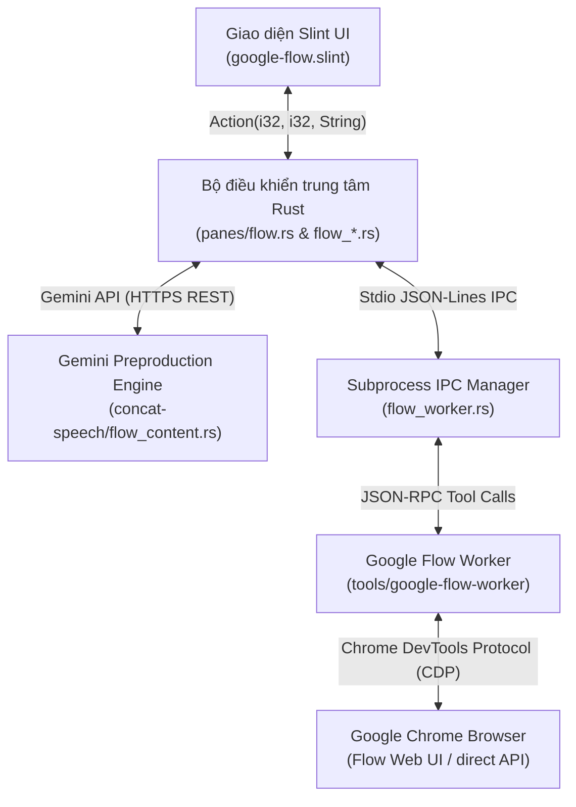

# Hướng Dẫn Kỹ Thuật & Cấu Trúc Mã Nguồn Google Flow Cho AI Agents

> **Dành cho AI Agents và Lập trình viên tiếp nhận dự án**: Tài liệu này mô tả toàn diện kiến trúc, các luồng dữ liệu, mã nguồn và bảng tra cứu action của hệ thống tích hợp **Google Flow & Google Vids Studio** trong ứng dụng **Concat / CDCedit**.

---

## 1. Tổng Quan Kiến Trúc (Architecture Overview)

Hệ thống Google Flow trong Concat bao gồm 3 lớp chính:



1. **Lớp Giao diện (Slint UI)**:
   - File: `src/crates/concat/ui/dialogs/google-flow.slint`
   - Giao diện 5 bước (Tabs 0–4): Kịch bản $\rightarrow$ Nhân vật $\rightarrow$ Cảnh $\rightarrow$ Tạo video $\rightarrow$ Kết quả.
   - Gửi sự kiện về Rust qua callback duy nhất `action(id, index, text)`.

2. **Lớp Điều khiển & Nghiệp vụ (Rust Core)**:
   - File chính: `src/crates/concat/src/panes/flow.rs` (State machine, quản lý hàng đợi, đồng bộ).
   - Mô-đun phụ trợ:
     - `flow_cast.rs`: Quản lý danh sách diễn viên, hồ sơ nhân vật, gán ID (`character_ids`).
     - `flow_scene.rs`: Cấu trúc kế hoạch cảnh (`ScenePlan`), lời thoại (`DialogueLine`), trích xuất cảnh.
     - `flow_visual.rs`: Quản lý thư viện ảnh chuẩn, ảnh 3 góc (`ReferenceImage`, gallery).
     - `flow_post.rs`: Xử lý hậu kỳ (delogo, upscale 1080p, import timeline).
     - `flow_accounts.rs`: Quản lý cấu hình đa tài khoản Google Flow (`accounts.json`).
     - `flow_worker.rs`: Quản lý spawn tiến trình worker Node.js và giao tiếp Stdio JSONL IPC.

3. **Lớp Trí tuệ Nhân tạo Tiền kỳ (Gemini Preproduction Engine)**:
   - File: `src/crates/concat-speech/src/flow_content.rs`
   - Sử dụng pool Gemini API key của ứng dụng để sinh nháp kịch bản, trích xuất nhân vật, trau chuốt lời thoại và tạo chỉ dẫn Agent Instructions.
   - Hướng dẫn Prompt: `.agents/skills/flow-prompt-craft/SKILL.md` và `src/crates/concat-speech/prompts/screenwriting.md`.

4. **Lớp Worker Tự động hóa Browser (Google Flow Worker)**:
   - Thư mục: `tools/google-flow-worker/`
   - Công nghệ: Node.js, TypeScript, Playwright Core kết nối qua CDP (`remote-debugging-port 9337` hoặc profile chuyên biệt).
   - Đảm nhiệm: Thao tác DOM Flow (composer, upload, mention `@`, agent instructions, click submit, tải video mp4).

---

## 2. Chi Tiết Các Tính Năng Nổi Bật

### 2.1. AI Khóa Agent Instructions Cấp Dự Án (`flow_sync_agent_instructions`)
- **Mục đích**: Thay vì phải nhồi nhét quy tắc ngoại hình nhân vật và góc máy vào từng cảnh, Flow hỗ trợ bảng **Agent instructions** cấp project. Khi đã bật toggle ON, Agent của Flow tự động áp dụng các quy tắc này xuyên suốt mọi cảnh tạo mới.
- **Quy trình hoạt động**:
  1. Người dùng bấm `✨ AI Khóa Agent Instructions vào Flow` (Action `160`).
  2. Rust gọi `concat_speech::flow_content::generate(keys, 49, &context)`.
  3. Gemini trả về mảng `instructions` gồm:
     - Các card nhân vật `Character: <Tên>`: Mô tả diện mạo người Việt, tóc, trang phục, phong thái.
     - Card toàn cục `Cinematic Camera & Lighting Rules`: Ép góc máy chậm, chuyển động êm dịu, không giật cục, không text/phụ đề.
  4. Rust tự động ánh xạ `character_id` với tên tệp ảnh chân dung đã tạo trên đĩa (`flow_*.jpg`).
  5. Rust dispatch tool `flow_sync_agent_instructions` sang worker.
  6. Worker (`agent-instructions.ts`):
     - Mở drawer `button[aria-label*="Agent instructions"]`.
     - Với mỗi mục: kiểm tra tiêu đề, điền guideline textarea, mở dialog `Select reference image`, chọn ảnh trùng tên và bấm `Add to instruction`.
     - Kích hoạt toggle switch sang ON (`aria-checked="true"`).
     - Bấm `Done` để lưu lại vào dự án Flow.

### 2.2. Tái Sử Dụng Kho Ảnh Tránh Upload Trùng Lặp (Asset Drawer Reuse)
- **Vấn đề cũ**: Mỗi khi tạo cảnh có ảnh nhân vật/khung đầu, worker đều upload lại ảnh từ máy tính, dẫn đến kho media của Flow bị trùng lặp hàng chục ảnh giống hệt nhau.
- **Giải pháp**:
  - Trong `tools/google-flow-worker/src/flow/composer.ts` hàm `attachReference`:
  - Worker mở ngăn kéo tài sản dự án trước và quét qua `button.asset-item`.
  - Nếu đã tồn tại ảnh có cùng tên tệp hoặc định danh, worker chỉ cần click vào ảnh đó và bấm `Add to prompt` (mất ~0.6s).
  - Chỉ khi ảnh chưa từng có trong Flow, worker mới bấm `Upload media`.

### 2.3. Điều Khiển Nhịp Độ Camera Điện Ảnh (Slow Cinematic Camera Pacing)
- **Bộ quy tắc Skill**: `.agents/skills/flow-prompt-craft/SKILL.md`.
- **Nguyên lý 5 phần**: `[Camera framing & slow pacing] + [Vietnamese subjects & appearance] + [Single continuous action] + [Environment & lighting] + [Exact dialogue]`.
- **Từ khóa ép nhịp chậm**:
  - `Static tripod shot, calm and steady pacing`
  - `Slow cinematic push-in at 0.5x pacing, smooth gimbal move`
  - `Gentle lateral tracking shot, steady and calm`
  - **Phủ định bắt buộc**: `No rapid pans, fast zooms, or sudden erratic camera moves. No on-screen text or subtitles.`

### 2.4. Khởi Tạo Kịch Bản Mới & Viết Lại Toàn Bộ
- **Action 47 ("Tạo kịch bản mới / Xóa trắng kịch bản")**:
  - Tự động sao lưu toàn bộ trạng thái hiện tại vào tệp `flow-before-new-script.json`.
  - Làm sạch văn bản kịch bản, danh sách cảnh (`scene_items`), danh sách kế hoạch (`plans`), nhưng vẫn giữ nguyên thư viện hồ sơ nhân vật chung.
- **Action 48 ("✨ AI viết lại kịch bản mới")**:
  - Sao lưu vào `flow-before-ai-new-script.json`.
  - Reset kịch bản và gọi Gemini tạo bộ cảnh mới từ cảnh 1 dựa trên ý tưởng tóm tắt (`brief`).

### 2.5. Hàng Đợi Tự Động 1-Click (1-Click Auto Pipeline)
- **Action 150**: Tự động duyệt qua toàn bộ các cảnh trong kịch bản:
  - Tự ghép prompt chuẩn hóa (`synchronized_prompt`).
  - Tự liên kết Scene Flow (lấy frame cuối cảnh trước làm khung đầu cảnh sau).
  - Tự xoay vòng tài khoản Flow khi gặp giới hạn quota.
  - Tự động gọi chuỗi xử lý hậu kỳ: Xóa logo Gemini (Action 151) $\rightarrow$ Nâng nét 1080p (Action 152) $\rightarrow$ Đưa clip trực tiếp vào Timeline Concat (Action 153).

---

## 3. Bảng Tra Cứu Action ID (`google-flow.slint` $\leftrightarrow$ `flow.rs`)

Mọi tương tác từ Slint UI đều đi qua callback `root.action(id, index, text)`. Dưới đây là bảng tra cứu đầy đủ:

| Action ID | Tham số (`index`, `text`) | Chức năng chi tiết |
| :--- | :--- | :--- |
| **1** | `0, text` | Chuyển tab trong dialog Flow (0: Kịch bản, 1: Nhân vật, 2: Cảnh, 3: Tạo video, 4: Kết quả). |
| **2** | `0, text` | Nhập URL dự án Google Flow (`https://flow.google.com/project/...`). |
| **3** | `0, text` | Chỉnh sửa văn bản prompt tự do trong tab Cảnh. |
| **4** | `index, ""` | Chọn video model (`0: omni-flash-1.2`, `1: veo-3.1-lite`, `2: veo-3.1-fast`, `3: veo-3.1-quality`). |
| **5** | `index, ""` | Chọn thời lượng video (3s đến 15s). |
| **6** | `index, ""` | Chọn tỷ lệ khung hình (`0: 9:16 dọc`, `1: 16:9 ngang`). |
| **7** | `0, text` | Nhập danh sách đường dẫn ảnh tham chiếu thủ công. |
| **10** | `0, ""` | Khởi chạy / kết nối lại Google Chrome với cổng remote debugging. |
| **11** | `0, ""` | Kiểm tra trạng thái đăng nhập và kết nối của Google Flow. |
| **12** | `0, ""` | Chuẩn bị prompt và gắn ảnh lên composer của Flow (chưa gửi, 0 credit). |
| **13** | `0, ""` | **Tạo video thật**: Gửi lệnh render trên Flow (tiêu tốn credit nếu bật). |
| **14** | `index, ""` | Nhập clip đã tạo vào Media Bin của dự án Concat. |
| **15** | `index, ""` | Mở thư mục chứa file video tải về trên Windows Explorer. |
| **20** | `0, text` | Thay đổi toàn văn kịch bản (tự động phân tích các cảnh phân tách bởi 2 dòng trống). |
| **21** | `0, text` | Thay đổi mô tả bối cảnh chung (`continuity`). |
| **22** | `0, text` | Thay đổi phong cách hình ảnh chung (`style`). |
| **23** | `index, ""` | Chọn cảnh làm việc hiện tại (`scene_index`). |
| **24** | `0, ""` | Đồng bộ prompt cho cảnh hiện tại từ mô tả cảnh, bối cảnh và nhân vật. |
| **25** | `0, ""` | Thêm một cảnh mới vào cuối kịch bản. |
| **26** | `index, ""` | Xóa cảnh theo chỉ số `index`. |
| **27** | `0, ""` | Xóa toàn bộ các cảnh trong kịch bản. |
| **28** | `0, ""` | Thêm một nhân vật mới vào hồ sơ diễn viên. |
| **29** | `index, text` | Chỉnh sửa hồ sơ/mô tả của nhân vật thứ `index`. |
| **30** | `index, ""` | Xóa nhân vật thứ `index`. |
| **40** | `0, text` | Cập nhật ý tưởng / yêu cầu sáng tạo (`brief`). |
| **41** | `0, ""` | **AI viết thêm cảnh**: Gọi Gemini viết nối tiếp kịch bản từ cảnh hiện có. |
| **42** | `0, ""` | **AI viết hồ sơ nhân vật**: Phân tích kịch bản và tạo danh sách nhân vật chuẩn Việt. |
| **43** | `0, ""` | **AI viết bối cảnh**: Tạo mô tả bối cảnh và không gian quay. |
| **44** | `0, ""` | **AI viết video prompt**: Tạo prompt cho cảnh đang chọn theo chuẩn `flow-prompt-craft`. |
| **45** | `0, ""` | **AI trau chuốt lời thoại**: Tối ưu thoại ngắn gọn, nhiều ẩn ý theo `dialogue-polisher`. |
| **46** | `0, ""` | **AI trích xuất nhân vật**: Đọc kịch bản thô và trích xuất danh sách nhân vật & vai diễn. |
| **47** | `0, ""` | **Tạo kịch bản mới / Xóa trắng**: Sao lưu `flow-before-new-script.json` và làm sạch kịch bản. |
| **48** | `0, ""` | **AI viết lại kịch bản mới**: Sao lưu và yêu cầu Gemini viết kịch bản hoàn toàn mới từ cảnh 1. |
| **50** | `index, ""` | Bật/tắt chọn cảnh tham gia vào hàng đợi tạo video tự động. |
| **51** | `0, ""` | Ghép / cập nhật prompt hàng loạt cho tất cả các cảnh đang chọn. |
| **53** | `0, ""` | Dừng hàng đợi sau khi cảnh đang chạy hoàn tất. |
| **80** | `index, ""` | Tạo ảnh chân dung đơn cho nhân vật (qua Flow Nano Banana hoặc Gemini Image). |
| **95** | `index, ""` | Chọn ảnh nhân vật từ tệp máy tính qua file dialog. |
| **100** | `0, ""` | Đọc thư viện nhân vật có sẵn trên dự án Flow đang mở (`flow_characters_list`). |
| **101** | `index, ""` | Tải hồ sơ & ảnh của nhân vật đã lưu trên Flow về Concat (`flow_character_download`). |
| **112** | `index, ""` | Gắn nhân vật Flow vào hồ sơ nhân vật nội bộ trong kịch bản. |
| **113** | `index, text` | Đặt vai diễn cho nhân vật (ví dụ: `người cha`, `bác sĩ`) để phân biệt người trùng tên. |
| **120** | `0, ""` | Mở hộp thoại Quản lý tài khoản Flow trong Cài đặt (`Settings → Google Flow`). |
| **121** | `index, ""` | Đổi tài khoản nguồn chính (`source_account_id`). |
| **122** | `index, ""` | Đổi tài khoản xử lý cho riêng cảnh đang chọn. |
| **123** | `0, text` | Nhập URL dự án Flow riêng cho cảnh đang chọn. |
| **124** | `index, ""` | Đổi nguồn tạo ảnh (`0: Google Flow`, `1: Gemini API`). |
| **125** | `index, ""` | Chọn model ảnh Flow (`Nano Banana Pro`, `2`, `2 Lite`). |
| **126** | `index, ""` | Chọn tỷ lệ ảnh Flow (`1:1`, `9:16`, `16:9`, `3:4`, `4:3`). |
| **127** | `index, ""` | Tạo bộ ảnh nhân vật 3 góc (chính diện, sau lưng, cận mặt ¾) trong khung 16:9. |
| **128** | `index, img_idx` | Chọn ảnh trong gallery làm ảnh chuẩn của nhân vật. |
| **129** | `index, img_idx` | Duyệt / bỏ duyệt bộ ảnh nhân vật (sheet). |
| **131** | `0, ""` | Tạo ảnh khung đầu cho cảnh đang chọn qua Flow. |
| **132** | `index, img_idx` | Xem phóng to ảnh trong bộ sưu tập. |
| **137** | `0, ""` | Bỏ khung đầu cảnh nhưng vẫn giữ ảnh trong thư viện. |
| **143** | `0, ""` | Bật/tắt tính năng **Scene Flow**: Tự lấy frame cuối cảnh trước làm khung đầu cảnh sau. |
| **144** | `index, ""` | Chọn chế độ tham chiếu (`0: Ingredients 3 ảnh`, `1: Start & End Frame`). |
| **146** | `index, ""` | Chọn nguồn render video (`0: Google Flow`, `1: Google Vids 8s Free`). |
| **150** | `0, ""` | **1-Click Auto Batch**: Tự động ghép prompt, nối cảnh, gửi render toàn bộ kịch bản. |
| **151** | `0, ""` | Bật/tắt tự động xóa logo Gemini sau khi tạo video. |
| **152** | `0, ""` | Bật/tắt tự động nâng nét 1080p sau khi tạo video. |
| **153** | `0, ""` | Bật/tắt tự động đưa video vào Timeline sau khi hoàn tất. |
| **160** | `0, ""` | **✨ AI Tạo & Khóa Agent Instructions vào Flow**: Tự động sinh quy tắc và đồng bộ vào Flow. |

---

## 4. Hướng Dẫn Thao Tác & Biên Dịch Dự Án (Developer & Agent Workflow)

### 4.1. Quy tắc cấu trúc thư mục
- Thư mục gốc Git: `c:\Users\Admin\Desktop\Concat-main\Concat-main\`
- Workspace Cargo gốc: `src/` (chứa `Cargo.toml`). **Luôn chạy lệnh cargo bên trong thư mục `src/` hoặc thông qua script PowerShell**.

### 4.2. Biên dịch và kiểm thử
Dự án được trang bị sẵn script build tự động phát hiện và liên kết toolchain nội bộ tại `.local-tools/`:

```powershell
# 1. Kiểm tra cú pháp nhanh (Typecheck cả Rust & Slint UI)
.\scripts\build-concat-desktop.ps1 -Mode Check

# 2. Chạy unit tests cho các mô-đun Flow Content
.\scripts\build-concat-desktop.ps1 -Mode ContentTest

# 3. Biên dịch bản nhị phân Quick Profile (tối ưu, không gây tràn RAM trên Windows)
.\scripts\build-concat-desktop.ps1 -Mode Build
```

File thực thi sau khi biên dịch nằm tại: `src/target/quick/cdcedit.exe`.

### 4.3. Biên dịch Worker Google Flow
Khi chỉnh sửa mã TypeScript trong `tools/google-flow-worker/src/`:

```powershell
cd tools/google-flow-worker
npm run build
# Copy bản build dist sang thư mục release desktop nếu cần kiểm thử trên app chạy thật
Copy-Item -Recurse -Force dist/* "C:\Users\Admin\Desktop\CDCedit-windows-x64\google-flow-worker\dist\"
```

### 4.4. Đảm bảo an toàn dữ liệu kịch bản
Mỗi khi can thiệp vào hàm thay đổi cấu trúc kịch bản hoặc nhân vật, luôn tuân thủ nguyên tắc:
1. Sao lưu trạng thái hiện tại qua `self.write_sibling("flow-before-<tên-thao-tác>.json", bytes)`.
2. Không bao giờ xóa đè ảnh hoặc tệp media đã tải nếu người dùng không yêu cầu rõ ràng.
3. Luôn bảo toàn các chú thích, cấu trúc mã nguồn hiện hữu.
