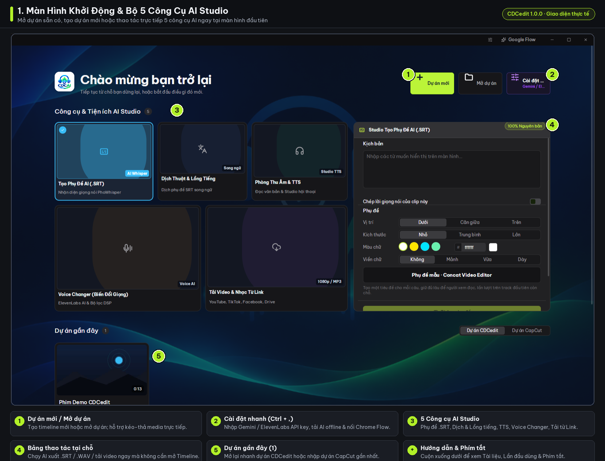
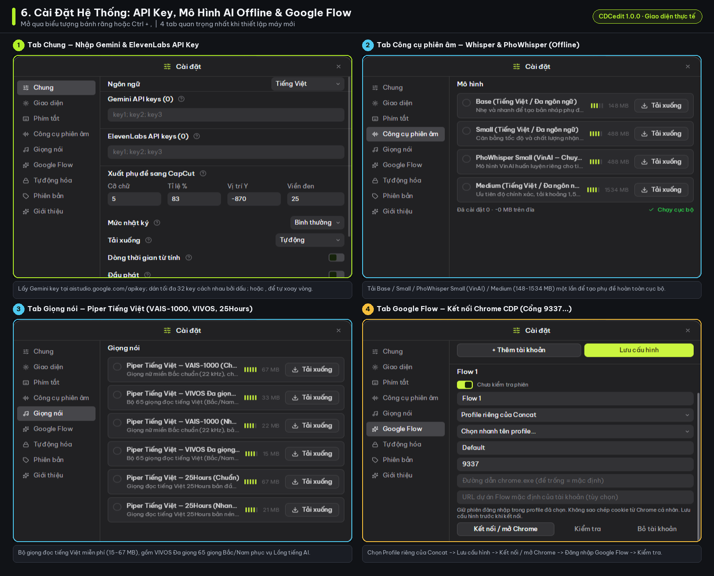
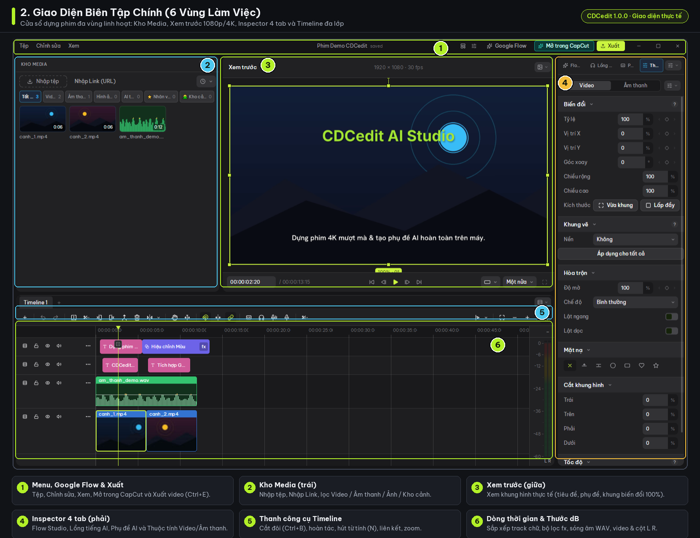
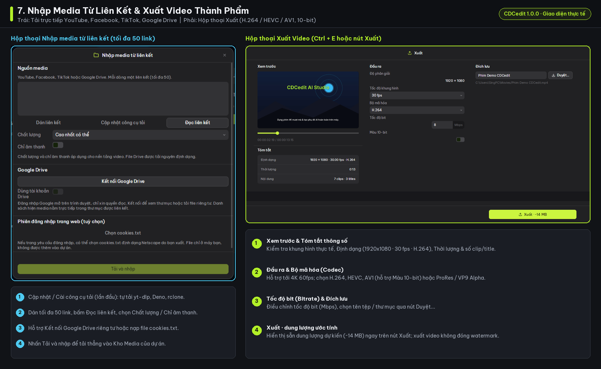
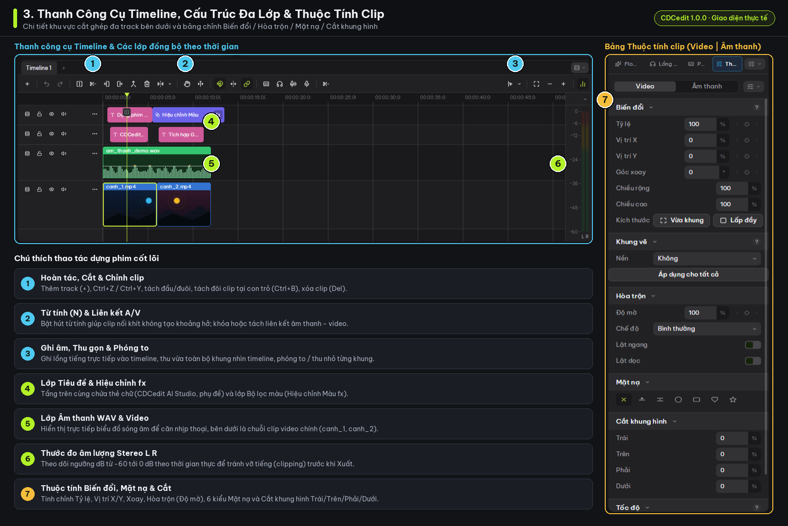
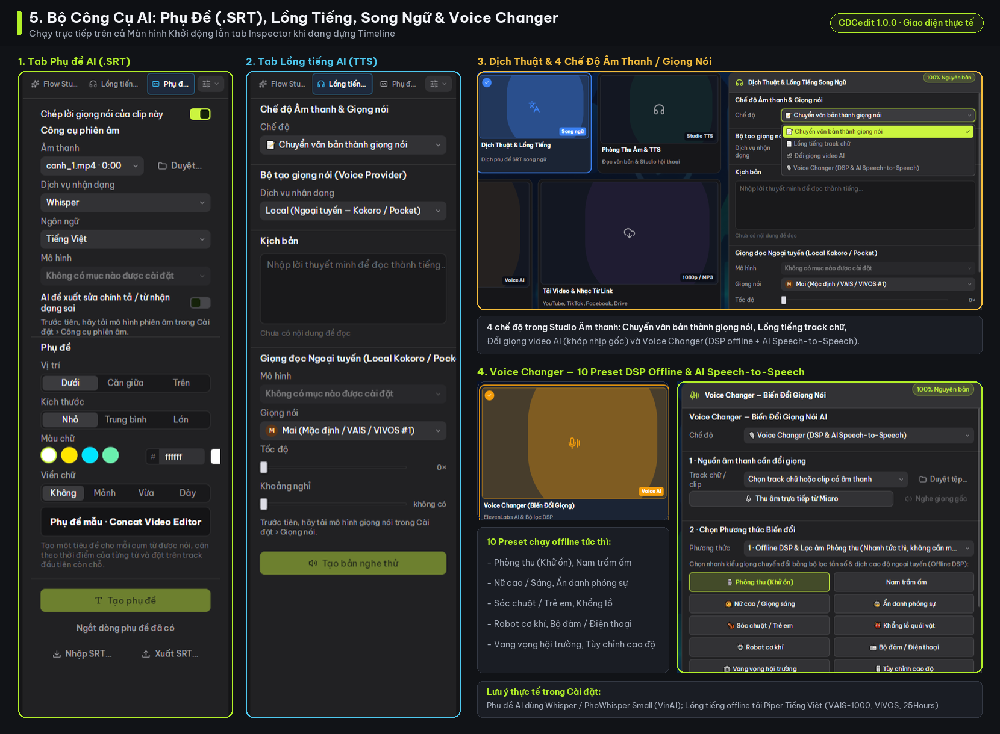
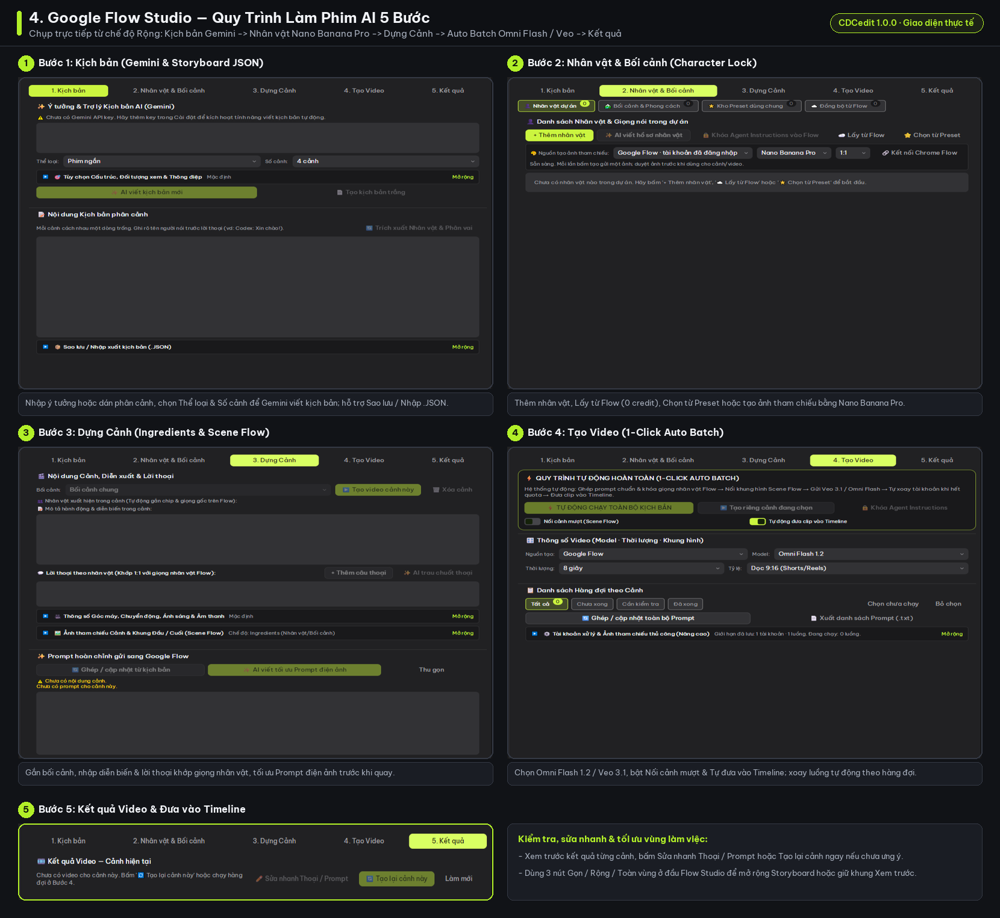

# Hướng Dẫn Sử Dụng Chi Tiết CDCedit

**CDCedit** là phần mềm dựng phim đa nền tảng (**Windows x86_64 Setup/MSI, macOS, Linux, Android, iOS**) với lõi xử lý viết bằng **Rust** kết hợp tăng tốc phần cứng **GPU**, tích hợp sẵn hệ sinh thái **AI Studio** (Phụ đề AI, Dịch thuật, Lồng tiếng TTS, Voice Changer), công cụ làm phim **Google Flow Studio 5 bước**, tải tư liệu từ liên kết và xuất video **4K 60fps 10-bit / HDR không đóng watermark**.

> [!TIP]
> Bạn có thể dùng CDCedit hoàn toàn miễn phí và không cần Internet cho các tác vụ dựng phim, thêm hiệu ứng, xuất 4K và chạy AI cục bộ (**Whisper / PhoWhisper Small VinAI**, **Piper Tiếng Việt – VAIS-1000 / VIVOS / 25Hours**, **10 preset DSP Voice Changer**) sau khi tải mô hình lần đầu trong phần **Cài đặt**.

---

## Mục Lục

1. [Màn hình Khởi động & Bộ công cụ AI Studio nhanh](#1-màn-hình-khởi-động--bộ-công-cụ-ai-studio-nhanh)
2. [Cài đặt ban đầu: Cách lấy API Key, Model Offline & Kết nối Google Flow](#2-cài-đặt-ban-đầu-api-key-model-offline--đa-tài-khoản-google-flow)
3. [Giao diện Biên tập chính & Tùy biến Bố cục](#3-giao-diện-biên-tập-chính--tùy-biến-bố-cục)
4. [Nhập Media từ máy & Tải Video / Nhạc từ Liên kết](#4-nhập-media-từ-máy--tải-video--nhạc-từ-liên-kết)
5. [Dựng phim trên Timeline, Chỉnh sửa Clip & Khung hình khóa](#5-dựng-phim-trên-timeline-chỉnh-sửa-clip--khung-hình-khóa)
6. [Bộ 4 Công cụ AI: Phụ đề, Dịch thuật, Lồng tiếng & Voice Changer](#6-bộ-4-công-cụ-ai-phụ-đề-dịch-thuật-lồng-tiếng--voice-changer)
7. [Làm phim AI với Google Flow Studio (Quy trình 5 bước)](#7-làm-phim-ai-với-google-flow-studio-quy-trình-5-bước)
8. [Xuất Video Thành Phẩm (4K 60fps, 10-bit HDR, Alpha)](#8-xuất-video-thành-phẩm-4k-60fps-10-bit-hdr-alpha)
9. [Bảng Phím tắt & Mẹo xử lý sự cố](#9-bảng-phím-tắt--mẹo-xử-lý-sự-cố)

---

## 1. Màn hình Khởi động & Bộ công cụ AI Studio nhanh

Ngay khi mở ứng dụng, màn hình khởi động cho phép bạn bắt đầu dựng phim hoặc truy cập nhanh 5 công cụ AI độc lập mà không cần tạo Timeline trước:

### Các thao tác chính tại màn hình khởi động

- **Dự án mới / Mở dự án**: Khởi tạo dự án biên tập mới hoặc mở lại các dự án đã lưu. Bạn cũng có thể **kéo và thả trực tiếp** tệp dự án hoặc video/ảnh/âm thanh vào cửa sổ khởi động để mở nhanh.
- **Công cụ & Tiện ích AI Studio** (gồm 5 thẻ công cụ kèm bảng thao tác ngay bên phải):
  1. **Tạo Phụ Đề AI (.SRT)**: Nhận dạng giọng nói từ video/audio và xuất file phụ đề `.SRT`.
  2. **Dịch Thuật & Lồng Tiếng**: Dịch file `.SRT` hoặc hội thoại video sang tiếng Việt kèm đối chiếu song ngữ.
  3. **Phòng Thu Âm & TTS**: Chuyển văn bản thành giọng nói hoặc lồng tiếng theo phụ đề/video.
  4. **Voice Changer (Biến Đổi Giọng)**: Đổi giọng trực tiếp bằng DSP offline hoặc AI Speech-to-Speech.
  5. **Tải Video & Nhạc Từ Link**: Tải nhanh video/âm thanh từ YouTube, Facebook, TikTok, Google Drive.

---

## 2. Cài đặt ban đầu: API Key, Model Offline & Đa tài khoản Google Flow

Nhấn biểu tượng bánh răng trên thanh tiêu đề hoặc dùng phím tắt `Ctrl + ,` để mở cửa sổ **Cài đặt**. Cửa sổ gồm **9 mục**: `Chung`, `Giao diện`, `Phím tắt`, `Công cụ phiên âm`, `Giọng nói`, `Google Flow`, `Tự động hóa`, `Phiên bản` và `Giới thiệu`.

### 2.1. Tab `Chung` — Cách lấy & nhập API Key, Hiệu năng dựng

Chi tiết cơ chế xoay vòng key xem thêm tại [API-KEY-ROTATION.md](./API-KEY-ROTATION.md).

#### A. Cách lấy & nhập Gemini API Key *(dùng cho Kịch bản Flow, Phụ đề AI, Dịch thuật & Gemini TTS)*

1. Mở trình duyệt và truy cập trang Google AI Studio: **`https://aistudio.google.com/apikey`**.
2. Đăng nhập bằng tài khoản Google của bạn, bấm nút tạo API key (**Create API key**), chọn hoặc tạo Google Cloud project theo hướng dẫn trên trang rồi sao chép chuỗi key vừa sinh.
3. Trong CDCedit, mở **Cài đặt (`Ctrl + ,`) → Chung → mục `Gemini API keys`**.
4. Dán API key vừa sao chép vào ô nhập *(ô hiển thị dạng mật khẩu bảo vệ)*.
5. **Nếu muốn nhập nhiều key để dự phòng giới hạn**: Dán tối đa **32 key** vào cùng ô đó, cách nhau bằng **dấu chấm phẩy (`;`) hoặc dấu phẩy (`,`)** *(hoặc dán danh sách cách nhau bằng khoảng trắng/xuống dòng)* — ví dụ `key1; key2; key3`. Khi gặp mã lỗi **HTTP `401`, `403` hoặc `429`**, CDCedit tự động xoay vòng sang key kế tiếp trong danh sách.

#### B. Cách lấy & nhập ElevenLabs API Key *(tùy chọn cho TTS cao cấp)*

1. Truy cập **`https://elevenlabs.io`**, đăng nhập tài khoản ElevenLabs và vào phần quản lý **API Keys** trong hồ sơ tài khoản để tạo/sao chép key.
2. Mở **Cài đặt (`Ctrl + ,`) → Chung → mục `ElevenLabs API keys`**, dán 1 hoặc tối đa **32 key** cách nhau bằng `;` hoặc `,`. *(Lưu ý: nếu xoay vòng nhiều key ElevenLabs, các tài khoản phải cùng có quyền truy cập Voice ID đang chọn).*

#### C. Hiệu năng dựng, Tải xuống & Bảo mật Key

- **Xuất phụ đề sang CapCut, Mức nhật ký & Tải xuống**: Tùy chỉnh cỡ chữ/tỷ lệ phụ đề khi xuất sang CapCut và chọn **Tải xuống (`Tự động` hoặc Mirror)** khi tải mô hình AI offline.
- **Dòng thời gian từ tính & Đầu phát**: Bật sẵn hỗ trợ hút khít clip và điều khiển đầu phát trên Timeline.

> [!NOTE]
> Trên Windows, toàn bộ ô API Key được **mã hóa cục bộ bằng DPAPI** gắn với tài khoản người dùng hiện tại, không lưu vào file dự án hay nhật ký hoạt động và chỉ gửi trực tiếp tới Google/ElevenLabs khi bạn bấm chạy tác vụ. Lưu ý rằng các API key thuộc cùng một Google Cloud project hoặc cùng tài khoản có thể dùng chung hạn mức (quota).

### 2.2. Tải mô hình AI Offline (`Công cụ phiên âm` & `Giọng nói`)

Để dùng AI miễn phí không phụ thuộc mạng Internet (`✓ Chạy cục bộ`):

1. Vào mục **Công cụ phiên âm** để tải 1 hoặc nhiều mô hình Whisper tiếng Việt: **`Base` (`148 MB`)**, **`Small` (`488 MB`)**, **`PhoWhisper Small (VinAI)` (`488 MB`)** hoặc **`Medium` (`1534 MB`)**.
2. Vào mục **Giọng nói** để tải gói giọng đọc **`Piper Tiếng Việt`** cục bộ: **`VAIS-1000 (Chuẩn 67 MB / Nhanh 22 MB)`**, **`VIVOS Đa giọng – 65 giọng Bắc/Nam (33 MB / 15 MB)`** hoặc **`25Hours (67 MB / 21 MB)`**.
3. Nếu kết nối mạng bị chậm khi tải mô hình, quay lại **Cài đặt → Chung → mục `Tải xuống`** để chuyển nguồn tải dự phòng. Sau khi tải xong một lần, các mô hình sẽ chạy 100% offline.

### 2.3. Tab `Google Flow` — Hướng dẫn kết nối từng bước & chạy 1–4 luồng

Tham khảo thêm chi tiết tại [FLOW_ACCOUNTS_VI.md](./FLOW_ACCOUNTS_VI.md). CDCedit tự động hóa **Google Flow** thông qua trình duyệt **Google Chrome** chạy giao thức CDP — bạn **không nhập mật khẩu Google vào ứng dụng** mà đăng nhập trực tiếp trong cửa sổ Chrome.

#### Cách kết nối tài khoản đầu tiên (`Flow 1` — Khuyên dùng cho người mới)

1. Đảm bảo máy đã cài **Google Chrome**.
2. Mở **Cài đặt (`Ctrl + ,`) → Google Flow**. Mặc định đã có sẵn hồ sơ **`Flow 1`** (hoặc bấm **`+ Thêm tài khoản`** nếu muốn tạo mới).
3. Ở danh sách chế độ kết nối, chọn **`Profile riêng của Concat`** *(chế độ khuyến nghị — tự mở một cửa sổ Chrome riêng và lưu giữ phiên đăng nhập cho các lần sau)*.
4. Giữ nguyên **Cổng CDP riêng** mặc định **`9337`** (tài khoản thứ 2 dùng cổng khác như `9338`…) và để trống ô **Đường dẫn `chrome.exe`** nếu dùng Chrome cài chuẩn của hệ thống.
5. *(Tùy chọn)* Dán **URL dự án Flow mặc định** (dạng `https://labs.google/fx/tools/flow/project/<UUID>` hoặc `https://flow.google.com/project/<UUID>`) nếu bạn muốn mở thẳng vào một project cố định.
6. Nhấn **`Lưu cấu hình`**, rồi nhấn **`Kết nối / mở Chrome`**.
7. Trên cửa sổ Chrome vừa bật lên, **đăng nhập thủ công tài khoản Google của bạn** vào Google Flow (và tạo/mở sẵn 1 project nếu đây là lần đầu dùng Flow).
8. Quay lại cửa sổ CDCedit, bấm **`Kiểm tra`** để xác nhận trạng thái:
   - `"Chưa mở Chrome · bấm Kết nối / mở Chrome"` → Chrome chưa chạy ở cổng đó, bấm lại **`Kết nối / mở Chrome`**.
   - `"Đã mở Chrome · cần đăng nhập Google Flow trong cửa sổ Chrome"` → hoàn tất đăng nhập trên trình duyệt vừa mở rồi bấm **`Kiểm tra`** lại.
   - **`"Đã kết nối & đăng nhập Google Flow"`** *(hoặc kèm 8 ký tự ID dự án)* → đã sẵn sàng sử dụng trong **Flow Studio**.

#### Hai chế độ kết nối Chrome nâng cao khác

- **`Chrome đang mở (CDP)`**: Dùng khi bạn muốn tự khởi chạy Chrome trước từ dòng lệnh với tham số `--remote-debugging-port=9337` (khớp đúng số cổng đã nhập). *Chrome mở thông thường không bật CDP sẽ không kết nối được theo cách này.*
- **`Profile có sẵn · thư mục riêng`**: Chỉ định thủ công đường dẫn tuyệt đối tới một thư mục `user-data-dir` riêng và chọn tên profile (`Default`, `Profile 1`...). *Hãy đóng cửa sổ Chrome đang dùng thư mục đó trước khi kết nối, và **không** trỏ vào thư mục `AppData\Local\Google\Chrome\User Data` mặc định của Chrome cá nhân.*

#### Thiết lập chạy song song 1–4 tài khoản (`Flow Studio`)

- Đặt **Tài khoản chạy đồng thời** (`1–4`) và **Tổng luồng tối đa** (`1–4`). Số tác vụ thực chạy đồng thời bằng **giá trị nhỏ hơn** giữa hai ô này (ví dụ đặt 3 tài khoản và 2 luồng sẽ chạy tối đa 2 cảnh cùng lúc).
- Trong phần **Flow Studio → Nhân vật & Bối cảnh**, nếu bật tạo ảnh tham chiếu bằng Flow, hãy chọn model ảnh và bật công tắc **Cho phép dùng credit Flow** khi bạn muốn cho phép trừ credit.

> [!IMPORTANT]
> Khi cấu hình nhiều tài khoản chạy song song (`2–4` tài khoản), mỗi tài khoản bắt buộc phải dùng **cổng CDP riêng** (`9337`, `9338`…) và **thư mục `user-data-dir` riêng biệt** (`Profile 1` và `Profile 2` nằm chung trong một thư mục không thể mở song song hai cổng khác nhau). Khi đang có hàng đợi chạy video, không chỉnh sửa cấu hình kết nối của tài khoản đang bận.

### 2.4. Các tab cài đặt khác

- **Giao diện**: Chuyển đổi chế độ **Tối / Sáng** và tùy chỉnh màu nhấn.
- **Phím tắt**: Xem bảng phím tắt đầy đủ và gán lại phím tắt dựng phim theo thói quen cá nhân.
- **Tự động hóa**: Cấu hình máy chủ tự động hóa **MCP / JSON-RPC** để điều khiển CDCedit từ tác nhân hoặc kịch bản ngoài.
- **Phiên bản & Giới thiệu**: Kiểm tra phiên bản ứng dụng và thông tin phát hành.

---

## 3. Giao diện Biên tập chính & Tùy biến Bố cục

Cửa sổ biên tập video của CDCedit chia thành các vùng làm việc rõ ràng và cho phép đổi loại vùng hiển thị qua bộ chuyển **Pane Switcher** ở góc mỗi khung (`Thư viện`, `Xem trước`, `Trình kiểm tra`, `Khung hình khóa`, `Dòng thời gian`):

### Thành phần từng khu vực

1. **Thanh Menu & Tiêu đề**: Truy cập nhanh `Tệp`, `Chỉnh sửa`, `Xem`, nút cài đặt **`Google Flow`**, **`Mở trong CapCut`** và nút **`Xuất`** (`Ctrl + E`).
2. **Kho Media (bên trái)**: Gồm nút **`Nhập tệp`**, **`Nhập Link (URL)`**, thanh lọc phân loại nhanh (`Tất cả`, `Video`, `Âm thanh`, `Hình ảnh`, `AI tạo`, `Nhân vật`, `Kho cảnh`) và bảng chuyển nhanh sang các thư viện Văn bản, Chuyển cảnh, Hiệu ứng, Bộ lọc, Điều chỉnh màu, Âm thanh tích hợp **CDCedit** (xem [AUDIO_LIBRARY.md](./AUDIO_LIBRARY.md)).
3. **Khung Xem trước (giữa)**: Hiển thị hình ảnh timeline theo thời gian thực (cùng khung căn chỉnh `100% · 0°`), thanh chọn chất lượng xem trước (`Một nửa`…) và cụm nút tua/phát khung hình.
4. **Thanh kiểm tra / Inspector (bên phải)**: Có **4 tab trên cùng** để chuyển đổi nhanh giữa:
   - **`Flow Studio`**: Xưởng làm phim AI 5 bước.
   - **`Lồng tiếng AI`**: Phòng thu âm, TTS và đồng bộ lồng tiếng.
   - **`Phụ đề AI`**: Tạo, căn chỉnh và sửa phụ đề tự động.
   - **`Thuộc tính`**: Tự mở khi chọn clip trên Timeline, chia 2 nhóm **`Video | Âm thanh`** (*Biến đổi, Khung vẽ, Hòa trộn, Mặt nạ, Cắt khung hình, Tốc độ…*).
5. **Thanh công cụ & Dòng thời gian (bên dưới)**: Nơi cắt ghép, sắp xếp và đồng bộ video, bộ lọc `fx`, chữ/phụ đề và sóng âm `.WAV` theo nhiều track kèm cột đo âm lượng Stereo `L R`.

---

## 4. Nhập Media từ máy & Tải Video / Nhạc từ Liên kết

Bên cạnh cách nhập tệp truyền thống từ máy tính (`Nhập tệp`, `Ctrl + I` hoặc kéo-thả trực tiếp vào Kho Media / Timeline), CDCedit tích hợp trình tải đa nền tảng giúp lấy thẳng video và âm thanh vào dự án (chi tiết xem [LINK-IMPORT.md](./LINK-IMPORT.md)):

### Các bước nhập từ liên kết (`Kho Media → Nhập Link (URL)` hoặc từ Màn hình Khởi động)

1. **Cập nhật / Cài công cụ tải (lần đầu)**: Nhấn nút **`Cập nhật công cụ tải`** để ứng dụng tự động tải bộ công cụ (`yt-dlp`, `Deno`, `rclone`, `FFmpeg`) có kiểm tra toàn vẹn mã **SHA-256**.
2. **Dán danh sách liên kết**: Hỗ trợ **YouTube, Facebook, TikTok** và **Google Drive** (dán mỗi dòng 1 đường dẫn, tối đa **50 link** / **1.000 file** mỗi lượt), hoặc bấm **`Dán liên kết`**.
3. **Chọn chất lượng đầu vào**: *Cao nhất có thể*, *1080p*, *720p* hoặc bật công tắc **`Chỉ âm thanh`**.
4. **Xử lý link riêng tư (tùy chọn)**:
   - Với **Google Drive riêng tư**: Bấm **`Kết nối Google Drive`** (đăng nhập OAuth với quyền chỉ đọc) và bật `Dùng tài khoản Drive` để duyệt thẳng thư mục Drive.
   - Với **trang yêu cầu đăng nhập**: Bấm **`Chọn cookies.txt`** (chuẩn Netscape; tệp chỉ giữ trên máy bạn).
5. Nhấn **`Đọc liên kết`** để kiểm tra danh sách, sau đó bấm **`Tải và nhập`**. Toàn bộ tệp tải về được lưu gọn trong thư mục `media/downloads/` của dự án.

> [!NOTE]
> Trên phiên bản **Android**, tính năng nhập từ liên kết hiện chỉ hỗ trợ **Google Drive** do giới hạn công cụ dòng lệnh trên nền tảng di động.

---

## 5. Dựng phim trên Timeline, Chỉnh sửa Clip & Khung hình khóa

Khu vực **Dòng thời gian (Timeline)** cho phép dựng đồng thời nhiều lớp video, lớp phủ, chữ/phụ đề và âm thanh với độ chính xác từng khung hình:

### 5.1. Thao tác cắt ghép cơ bản trên Timeline

- **Cắt đôi clip tại vị trí con trỏ**: Di chuyển đầu phát tới vị trí mong muốn và nhấn `Ctrl + B` (hoặc công cụ cắt trên thanh công cụ timeline).
- **Di chuyển & Hút từ tính**: Bật phím `N` để kích hoạt chế độ **Dòng thời gian từ tính**, giúp các clip tự hút khít vào nhau hoặc khít vào mốc thời gian mà không tạo khoảng hở ngoài ý muốn.
- **Nhân đôi / Sao chép / Hoàn tác**: Dùng `Ctrl + C` / `Ctrl + V` để sao chép-dán, `Ctrl + D` để nhân đôi clip, `Del` / `Backspace` để xóa clip, `Ctrl + Z` để hoàn tác và `Ctrl + Shift + Z` / `Ctrl + Y` để làm lại.
- **Thêm chuyển cảnh, văn bản, hiệu ứng, bộ lọc**: Chuyển qua các tab tương ứng ở Ngăn Thư viện bên trái rồi kéo thả vào điểm nối giữa 2 clip hoặc lên track phía trên clip cần áp dụng.

### 5.2. Chỉnh sửa chuyên sâu trong tab `Thuộc tính` & `Khung hình khóa`

Khi chọn một clip trên Timeline, tab **Thuộc tính** (bên phải) sẽ hiển thị hai nhóm **`Video | Âm thanh`**, hoặc bạn có thể chuyển một khung qua pane **Khung hình khóa** để tinh chỉnh:

- **Biến đổi, Khung vẽ & Hòa trộn**: Chỉnh `Tỷ lệ`, `Vị trí X / Y`, `Góc xoay`, `Vừa khung / Lấp đầy`, nền `Khung vẽ`, `Độ mờ`, chế độ hòa trộn và lật ngang/dọc.
- **Mặt nạ & Cắt khung hình**: Khoanh vùng với 6 kiểu mặt nạ hình học và cắt biên `Trái / Trên / Phải / Dưới`.
- **Tốc độ, Tách nền, Phông xanh & Chống rung**: Điều chỉnh tốc độ phát, xóa hậu cảnh / lọc phông xanh (`Chroma key`), giảm rung lắc và tăng cường nét AI.
- **Chỉnh màu & Bộ lọc (`fx`)**: Kéo lớp điều chỉnh màu (ví dụ *Hiệu chỉnh Màu `fx`*) hoặc tinh chỉnh độ sáng, tương phản, nhiệt màu.
- **Khung hình khóa (Keyframes)**: Gắn các điểm mốc thời gian bằng các nút thoi cạnh từng thông số để tạo chuyển động zoom/pan mượt mà.

---

## 6. Bộ 4 Công cụ AI: Phụ đề, Dịch thuật, Lồng tiếng & Voice Changer

Bạn có thể mở 4 công cụ này ngay từ **Màn hình Khởi động** hoặc dùng trực tiếp ở tab **Phụ đề AI** / **Lồng tiếng AI** ngay trong khi đang biên tập Timeline:

### 6.1. Studio Tạo Phụ Đề AI (.SRT)

- **Chép lời & lựa chọn bộ máy**: Bật công tắc **`Chép lời giọng nói của clip này`**, chọn tệp âm thanh/clip cần nhận dạng, chọn `Dịch vụ nhận dạng` chạy hoàn toàn offline với **Whisper / PhoWhisper** hoặc **Gemini 3.5 Transcribe** qua API Key, và chọn ngôn ngữ (ví dụ **Tiếng Việt**).
- **Khả năng thông minh**:
  - **Phân biệt 2 người nói** và tự động tách thành **2 Track phụ đề riêng**.
  - **Ngắt câu thông minh (2.5–9 giây)** giúp phụ đề vừa mắt người xem, không bị tràn dòng.
  - Bật **`AI đề xuất sửa chính tả / từ nhận dạng sai`** trước khi ghi nhận.
- **Kiểu dáng & Áp dụng**: Tùy chỉnh `Vị trí`, `Kích thước`, `Màu chữ`, `Viền chữ`, rồi nhấn **`T Tạo phụ đề`** (hoặc **`T Thêm phụ đề`** khi nhập thủ công), **`Ngắt dòng phụ đề đã có`** và **`Nhập SRT...` / `Xuất SRT...`**.

### 6.2. Dịch Thuật & Lồng Tiếng Song Ngữ

1. Nạp file `.SRT` có sẵn hoặc chạy nhận dạng tiếng gốc từ video/âm thanh.
2. Nhập **Glossary** (danh sách tên nhân vật, địa danh, thuật ngữ chuyên ngành) để AI dịch nhất quán xuyên suốt cả bộ phim.
3. Thực hiện **Dịch sang tiếng Việt** và đối chiếu từng dòng ở giao diện song ngữ (*Câu gốc ↔ Bản dịch*).
4. Nếu câu dịch quá dài so với nhịp thoại gốc, bấm nút **AI rút gọn** để cô đọng câu chữ sao cho vừa khớp thời lượng nói trên video.
5. Chọn **Lưu SRT Việt / Song ngữ** hoặc chuyển qua menu **Chế độ** (`Lồng tiếng track chữ` / `Đổi giọng video AI`) để sang bước tạo giọng đọc.

### 6.3. Phòng Thu Âm & Lồng Tiếng AI (TTS & Gemini 3.8 Studio)

Xem thêm tài liệu chi tiết tại [DUBBING.md](./DUBBING.md) và [GEMINI-STUDIO.md](./GEMINI-STUDIO.md).

- **Chế độ hoạt động** (trong danh sách `Chế độ`):
  1. **`Chuyển văn bản thành giọng nói`**: Đọc đoạn kịch bản thành file âm thanh.
  2. **`Lồng tiếng track chữ`**: Tự sinh giọng đọc bám sát thời điểm xuất hiện của từng thẻ phụ đề trên Timeline.
  3. **`Đổi giọng video AI`**: Khớp câu thoại mới vào từng mốc giây trên video gốc (dùng Whisper cục bộ căn chỉnh tốc độ trong khoảng `0.25x–4x`).
- **3 nguồn giọng đọc (`Dịch vụ nhận dạng`)**:
  - **`Local (Ngoại tuyến – Kokoro / Pocket)`**: Chạy offline hoàn toàn miễn phí bằng các bộ giọng **`Piper Tiếng Việt`** (`VAIS-1000`, `VIVOS Đa giọng 65 giọng Bắc/Nam`, `25Hours` — chọn giọng mẫu như `Mai (Mặc định / VAIS / VIVOS #1)` sau khi tải trong `Cài đặt → Giọng nói`).
  - **Gemini TTS**: Hỗ trợ tới **20.000 ký tự / 30 phút** (hoặc căn timing SRT đã rà soát tới **100 câu / 30 phút**), tùy chỉnh thanh **Temperature (`0–2`)** để kiểm soát độ biến hóa biểu cảm.
  - **ElevenLabs**: Dùng giọng chất lượng cao qua ElevenLabs API Key.
- **6 công cụ chuyên sâu trong Gemini 3.8 Studio**: `Hội thoại A/B`, `Phong cách & biểu cảm`, `Thiết kế giọng từ mô tả`, `Tái tạo giọng từ mẫu` *(yêu cầu đoạn mẫu 10–30 giây kèm clip xác nhận đồng ý / consent clip)*, `Thư viện giọng mở rộng` và `Phản ứng xen lời` *(dùng cú pháp `|...|`)*. Hỗ trợ chèn thẻ cảm xúc ngay trong lời thoại như `<laugh>`, `<cry>`, `<sigh>`.
- **Xuất kết quả**: Nhấn **`Tạo bản nghe thử`** để kiểm tra và áp dụng xuống Timeline hoặc lưu tệp `.WAV`.

### 6.4. Voice Changer – Biến Đổi Giọng Nói

- Chọn nguồn âm thanh từ **`Track chữ / clip`** có sẵn hoặc nhấn **`Thu âm trực tiếp từ Micro`**.
- **10 Preset DSP Offline tức thì** *(không cần Internet)*: **`Phòng thu (Khử ồn)`**, **`Nam trầm ấm`**, **`Nữ cao / Giọng sáng`**, **`Ẩn danh phóng sự`**, **`Sóc chuột / Trẻ em`**, **`Khổng lồ quái vật`**, **`Robot cơ khí`**, **`Bộ đàm / Điện thoại`**, **`Vang vọng hội trường`**, và **`Tùy chỉnh cao độ`**.
- **Tinh chỉnh nâng cao**: Kéo thanh Pitch/tốc độ ở chế độ tùy chỉnh, hoặc chuyển `Phương thức` sang **AI Speech-to-Speech** (ElevenLabs) để đổi sang chất giọng mới mà vẫn giữ nguyên ngữ điệu gốc.

---

## 7. Làm phim AI với Google Flow Studio (Quy trình 5 bước)

Mở tab **Flow Studio** ở khung bên phải để sản xuất một dự án phim ngắn hoàn chỉnh từ ý tưởng đến các cảnh quay đồng bộ nhân vật (xem đầy đủ chi tiết kỹ thuật tại [GOOGLE_FLOW.md](./GOOGLE_FLOW.md) và [SCREENWRITING_SKILLS.md](./SCREENWRITING_SKILLS.md)):

> [!TIP]
> Trên thanh công cụ **Flow Studio**, bạn có thể nhấn chuyển kích thước vùng làm việc giữa **`Gọn`**, **`Rộng`** *(hiển thị cùng khung Xem trước)* hoặc **`Toàn vùng`**. Khi ở chế độ rộng (`>= 880px`), thanh **`Storyboard`** bên trái sẽ hiện ra để chuyển nhanh giữa từng cảnh; các ô nhập có công cụ AI hỗ trợ viết lại hoặc trau chuốt câu chữ tại chỗ.

### Bước 1: `1. Kịch bản`

- Nhập ý tưởng vào mục **`Ý tưởng & Trợ lý Kịch bản AI (Gemini)`**, chọn **`Thể loại`** & **`Số cảnh`** (`1–12 cảnh`) rồi bấm **`AI viết kịch bản mới`** (hoặc **`Tạo kịch bản trắng`** để tự dán kịch bản), sau đó bấm **`Trích xuất Nhân vật & Phân vai`**.
- Hỗ trợ **`Sao lưu / Nhập xuất kịch bản (.JSON)`**; ứng dụng tự tạo bản sao lưu trước khi ghi đè.

### Bước 2: `2. Nhân vật & Bối cảnh` (Character Lock)

- Quản lý theo 4 nhóm: **`Nhân vật dự án`**, **`Bối cảnh & Phong cách`**, **`Kho Preset dùng chung`** và **`Đồng bộ từ Flow`**.
- Gắn ảnh tham chiếu khóa ngoại hình (**Character Lock**) bằng nút **`+ Thêm nhân vật`** / **`AI viết hồ sơ nhân vật`**, hoặc:
  1. **Chọn ảnh từ máy**: Hỗ trợ `PNG`, `JPG`, `JPEG`, `WebP` (tối đa `32 MB`/ảnh, tối đa `8` ảnh cục bộ).
  2. **Tạo ảnh bằng Google Flow**: Chọn model ảnh **`Nano Banana Pro`**, **Nano Banana 2** hoặc **Nano Banana 2 Lite** cùng tỷ lệ khung (`1:1`, `16:9`, `9:16`…).
  3. **`Lấy từ Flow` (0 credit)** hoặc **`Chọn từ Preset`**: Tái sử dụng nhân vật và giọng nói đã tạo sẵn trên tài khoản Google Flow hoặc thư viện dùng chung mà **không tốn credit**.

### Bước 3: `3. Dựng Cảnh`

- Gắn **`Bối cảnh`**, nhập **`Mô tả hành động & diễn biến trong cảnh`**, thêm thoại khớp giọng nhân vật (**`+ Thêm câu thoại`** / **`AI trau chuốt thoại`**) và mở rộng **`Thông số Góc máy, Chuyển động, Ánh sáng & Âm thanh`**.
- Mở **`Ảnh tham chiếu Cảnh & Khung Đầu / Cuối (Scene Flow)`** để chọn 1 trong **2 chế độ ghép tham chiếu**: **`Ingredients (Nhân vật/Bối cảnh)`** *(tối đa 3 ảnh thành phần)* hoặc **Khung Đầu / Cuối**.
- Bấm **`AI viết tối ưu Prompt điện ảnh`** để gộp thông số thành prompt chuẩn rồi gửi tạo từng cảnh ngay bằng **`Tạo video cảnh này`**.

### Bước 4: `4. Tạo Video`

- Sử dụng khung **`QUY TRÌNH TỰ ĐỘNG HOÀN TOÀN (1-CLICK AUTO BATCH)`**: bật **`Nối cảnh mượt (Scene Flow)`** và **`Tự động đưa clip vào Timeline`**, chọn **`Model`** (ví dụ **`Omni Flash 1.2`** hoặc **Veo 3.1**), `Thời lượng`, `Tỷ lệ` rồi nhấn **`TỰ ĐỘNG CHẠY TOÀN BỘ KỊCH BẢN`** (hoặc đẩy **`Tạo riêng cảnh đang chọn`**).
- Phía dưới có bảng **`Danh sách Hàng đợi theo Cảnh`** (`Ghép / cập nhật toàn bộ Prompt`, `Xuất danh sách Prompt (.txt)`) cùng cài đặt phân bổ luồng trên **1–4 tài khoản / luồng Chrome** và bảo vệ tránh gửi lặp job.

### Bước 5: `5. Kết quả`

- Kiểm tra từng clip ở **`Kết quả Video — Cảnh hiện tại`** (`Sửa nhanh Thoại / Prompt`, **`Tạo lại cảnh này`**, `Làm mới`) và quản lý tại **`Thư viện Kết quả`** để đưa các cảnh đạt yêu cầu xuống Timeline CDCedit, ghép nhạc và xuất phim.

---

## 8. Xuất Video Thành Phẩm (4K 60fps, 10-bit HDR, Alpha)

Khi hoàn tất dựng phim trên Timeline, mở hộp thoại xuất video qua nút **`Xuất`** ở góc trên phải hoặc phím tắt `Ctrl + E` (xem khung bên phải của [hình mục 4](#4-nhập-media-từ-máy--tải-video--nhạc-từ-liên-kết)):

1. **Xem trước & Tóm tắt**: Kiểm tra khung hình theo thanh tua, xem tóm tắt **`Định dạng`**, **`Thời lượng`** và **`Nội dung`** (số clips · titles).
2. **Đầu ra & Bộ mã hóa (`Codec`)**: Chọn **`Độ phân giải`** (lên tới `3840 × 2160 (4K)`), **`Tốc độ khung hình`** (tới `60 fps`), **`Bộ mã hóa`** (`H.264`, `HEVC`, `AV1`, hoặc `ProRes 4444 (.mov)` / `VP9` giữ kênh **Alpha**), bật **`Màu 10-bit`** *(khi dùng HEVC / AV1 trên GPU hỗ trợ)* và chỉnh **`Tốc độ bit (Mbps)`**.
3. **Đích lưu & Xuất**: Nhập tên tệp / nhấn **`Duyệt...`** chọn thư mục, xem trước dung lượng dự kiến ngay trên nút **`Xuất · ~... MB`** rồi bấm xuất. Video xuất ra **hoàn toàn không đóng watermark**.

---

## 9. Bảng Phím tắt & Mẹo xử lý sự cố

### 9.1. Bảng Phím tắt chính

> [!NOTE]
> Toàn bộ phím tắt biên tập dưới đây (trừ các phím cửa sổ cố định) đều có thể xem mô tả chi tiết và tùy chỉnh lại trong **Cài đặt → Phím tắt** (hoặc xem [KEYBOARD_SHORTCUTS.md](./KEYBOARD_SHORTCUTS.md)).

| Nhóm thao tác | Tổ hợp phím |
| :--- | :--- |
| **Phát lại & Di chuyển con trỏ** | `Space` *(Phát / Tạm dừng)* · `Home` / `End` · `↑` / `↓` · `←` / `→` · `Shift + ←` / `Shift + →` |
| **Biên tập trên Timeline** | `Ctrl + B` *(Cắt clip tại con trỏ)* · `B` · `Q` · `W` · `F` · `Del` / `Backspace` *(Xóa)* · `Shift + Del` · `Ctrl + Z` *(Hoàn tác)* · `Ctrl + Shift + Z` / `Ctrl + Y` *(Làm lại)* · `Ctrl + A` / `Ctrl + C` / `Ctrl + V` / `Ctrl + D` *(Chọn tất cả / Sao chép / Dán / Nhân đôi)* · `H` · `N` *(Bật/tắt từ tính)* · `M` · `S` |
| **Dự án & Hệ thống** | `Ctrl + S` *(Lưu dự án)* · `Ctrl + E` *(Xuất video)* · `Ctrl + I` *(Nhập media)* · `Ctrl + ,` *(Mở Cài đặt)* · `Ctrl + =/+` & `Ctrl + -` *(Phóng to / Thu nhỏ)* |
| **Phím cửa sổ cố định** | `Ctrl + O` · `Ctrl + W` · `Ctrl + Q` · `F10` · `Escape` |

### 9.2. Xử lý nhanh một số tình huống thường gặp

- **Lỗi hết lượt / Rate limit Gemini API (`429`)**: Vào `Cài đặt → Chung → Gemini API keys`, nhập tối đa **32 key** cách nhau bằng dấu chấm phẩy `;` hoặc dấu phẩy `,` để hệ thống tự xoay vòng sang key kế tiếp khi gặp HTTP `401 / 403 / 429`.
- **Không kết nối được tài khoản Google Flow thứ 2 trở đi**: Kiểm tra lại ở `Cài đặt → Google Flow` xem từng tài khoản đã có **cổng CDP riêng** (`9337`, `9338`…) và nếu chọn `Profile có sẵn · thư mục riêng` thì đã tách riêng thư mục `user-data-dir` (không dùng `Google/Chrome/User Data` mặc định) hay chưa; sau đó bấm **`Lưu cấu hình`** → **`Kết nối / mở Chrome`** → đăng nhập trên Chrome → **`Kiểm tra`**.
- **Dán link YouTube/TikTok báo thiếu công cụ tải**: Bấm nút **`Cập nhật công cụ tải`** trong hộp thoại `Nhập media từ liên kết` để cài đặt bộ `yt-dlp / Deno / rclone / FFmpeg`. Nếu link riêng tư hoặc yêu cầu xác thực tài khoản, hãy bấm `Kết nối Google Drive` (chỉ đọc) hoặc nạp tệp `cookies.txt`.
- **Không thấy giọng Local hoặc Whisper hoạt động offline**: Mở `Cài đặt → Công cụ phiên âm` và `Cài đặt → Giọng nói` để kiểm tra xem mô hình **`Whisper / PhoWhisper Small`** và **`Piper Tiếng Việt`** đã hoàn tất tải về chưa; nếu tải chậm, hãy vào `Cài đặt → Chung → Tải xuống` để đổi sang nguồn dự phòng.
