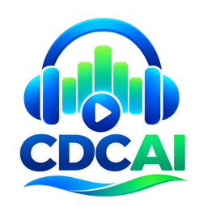

<h1 align="center">CDCAi</h1>

CDCAi is a customized video editor derived from [Concat](https://github.com/jub0t/Concat). Original author and license notices are retained. Build this fork to use CDCAi features; upstream release links below refer to the original project.

CDCAi **beta** aşamasında: çalışıyor, ama hâlâ pürüzleri var. Bir tane bulduğunuzda [söyleyin](https://github.com/jub0t/Concat/issues).

**Platformlar**

- ✅ **Windows** · x86_64 (ARM derlemelerine ara verildi, bkz. [#326](https://github.com/jub0t/Concat/issues/326)). Bir kurulum ve bir `.msi`. SmartScreen imzasız bir derlemeyi durdurursa: **Daha fazla bilgi** › **Yine de çalıştır**
- ✅ **macOS** · Intel ve Apple Silicon. macOS imzasız bir derlemeyi açmayı reddederse: `xattr -dr com.apple.quarantine /Applications/CDCAi.app`
- ✅ **Linux** · x86_64 ve ARM. `.deb`, `.rpm`, `.AppImage` ve bir Arch paketi. Ayrıca her sürümün x86_64 `.deb`’ini saran ve onunla güncellenen topluluk Flatpak deposu **[Flatpark](https://flatpark.org/apps/app.concat.editor/)** üzerinde bir Flatpak
- ✅ **Android** · telefonlar ve tabletler
- ✅ **iOS / iPadOS** · iPhone ve iPad, sideload ile

✅ Destekleniyor · 🚧 Çalışılıyor · 🧪 Test edilecek

**Sistem gereksinimleri** ve isteğe bağlı model boyutları [web sitesinde](https://concatenate.pages.dev/guides/system-requirements).

**[Code signing policy](../CODE_SIGNING.md)**

## Nasıl katkıda bulunulur

> [!IMPORTANT]
> Katkıda bulunmanın en iyi yolu [Releases](https://github.com/jub0t/Concat/releases) sayfasından bir derleme alıp kullanmaktır: nerede bozulduğunu bulun ve nerede daha iyi olabileceğini söyleyin.
>
> Kod yazmaya hazır mısınız? [CONTRIBUTING.md](../CONTRIBUTING.md) kurulumu, ağacın düzenini, çalıştırılacak denetimleri ve katkıların nasıl lisanslandığını anlatır. CDCAi’i bir betikten, servisten ya da ajandan mı sürüyorsunuz? [Geliştirici belgeleri](https://concatenate.pages.dev/docs) CDCAi API’sini ve taşıyıcılarını anlatır: JSON-RPC ve gRPC. Proje [bu tartışmada](https://github.com/jub0t/Concat/discussions/3) duyuruldu.
> 
> Katkıda bulunanlar Discord sunucusunda bir `@Contributor` rolü alabilir: istemeniz yeter.

## Yıldız geçmişi

## Katkıda bulunanlar

## DMCA

Bu depodaki, sürümlerindeki ya da dağıttığı bir paket veya modeldeki bir şeyin telif hakkınızı ihlal ettiğini düşünüyorsanız [jub0trd@gmail.com](mailto:jub0trd@gmail.com) adresine şunları içeren bir e-posta gönderin: sahibi olduğunuz eserin açıklaması, ihlal eden içeriğin burada göründüğü yerin bağlantısı, iletişim bilgileriniz, kullanıma sizin, temsilcinizin ya da yasanın izin vermediğine iyi niyetle inandığınızı belirten bir beyan ve yalan beyanın cezai sorumluluğunu üstlenerek bildirimin doğru olduğunu ve hak sahibi ya da onun adına hareket etmeye yetkili olduğunuzu belirten, fiziksel veya elektronik imzanızı taşıyan bir beyan. Geçerli bildirimler hızla işleme alınır ve içeriği kaldırılan herkes aynı adrese karşı bildirim gönderebilir.
