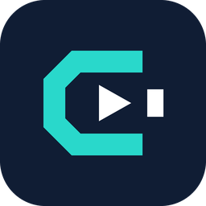

<h1 align="center">CDCedit</h1>

CDCedit is a customized video editor derived from [Concat](https://github.com/jub0t/Concat). Original author and license notices are retained. Build this fork to use CDCedit features; upstream release links below refer to the original project.

CDCedit є безкоштовним відеоредактором з відкритим кодом і альтернативою CapCut для macOS, Windows, Linux та Android. Він уміє те, заради чого люди насправді відкривають CapCut: автоматичні субтитри, синтез мовлення, видалення фону, анімацію за ключовими кадрами, ефекти й титри, багатодоріжковий монтаж, експорт у 4K. І без пасток: ані водяного знака, ані облікового запису, ані підписки, ані завантаження на сервер.

Усе працює локально на нативному рушії на Rust із GPU-композитором. Встановіть, перетягніть матеріал, ріжте. Моделі ШІ для субтитрів, голосів і вирізання фону завантажуються один раз із налаштувань і далі працюють офлайн. Ваш матеріал ніколи не залишає ваш диск.

**Підходить для:** TikTok, Reels і Shorts, відео на YouTube, навчальних роликів і записів екрана, фрагментів подкастів, мемів.

**І для машин теж:** API JSON-RPC, щоб скрипти та ШІ-агенти теж могли монтувати в ньому відео.

## Головне

- 🚫 **Без водяних знаків. Без облікового запису. Без платного доступу.** Ніколи.
- 🔒 **100 % локально.** Нічого не завантажується. Працює офлайн.
- 💬 **Автоматичні субтитри.** Локальний Whisper. Оберіть розмір моделі, і стилізовані субтитри опиняться на таймлайні.
- 🗣️ **Синтез мовлення + клонування голосу.** Безкоштовні локальні голоси або будь-який голос із кількох секунд запису.
- 🧍 **Видалення фону.** Люди, об’єкти або намалюйте маску самі.
- 🎞️ **Ключові кадри.** Положення, масштаб, поворот, прозорість, гучність, параметри ефектів. Вбудований редактор кривих.
- ✨ **100 ефектів, фільтрів і переходів.** Рендер на GPU, наживо в попередньому перегляді.
- ✂️ **Швидкий монтаж.** Розрізати, підрізати, ripple, об’єднати, стоп-кадр, швидкість. Магнітний таймлайн за бажанням.
- 🎚️ **Багато доріжок, багато таймлайнів.** Кілька монтажів в одному проєкті. Режими накладання, кадрування, віддзеркалення.
- 📝 **Титри.** Шрифти, обведення, тінь, підкладка. Пресети для старту.
- 🎙️ **Чищення голосу одним перемикачем.** Шумозаглушення, покращення голосу, вирівнювання гучності. Плюс бурундук, робот, телефон і компанія.
- 📤 **Експорт.** H.264, HEVC, AV1. До 4K 60, 10-бітний колір.
- 🦀 **Нативний рушій на Rust.** GPU-композитор, проксі, апаратне декодування. 4K перемотується плавно.
- 🤖 **Скриптований.** API JSON-RPC, через який скрипти та ШІ-агенти можуть монтувати відео. Збірка з вихідного коду додає gRPC та інструмент командного рядка.
- 🖥️ **macOS, Windows, Linux, Android.** 26 мов. Один застосунок, ті самі файли проєктів.

## Завантажити

Два шляхи:

1. **[Сайт](https://concatenate.pages.dev/#download)** добере збірку під вашу машину. Почніть звідси.
2. **[GitHub Releases](https://github.com/jub0t/Concat/releases)** містить кожну збірку для кожної платформи, з інсталяторами, пакетами й контрольними сумами. Коли хочеться обрати самому.

CDCedit у **беті**: він працює, але шорсткості ще є. [Повідомте](https://github.com/jub0t/Concat/issues), якщо знайдете.

**Платформи**

- ✅ **Windows** · x86_64 (збірки для ARM призупинено, див. [#326](https://github.com/jub0t/Concat/issues/326)). Інсталятор і `.msi`. Якщо SmartScreen зупиняє непідписану збірку: **Докладніше** › **Все одно запустити**
- ✅ **macOS** · Intel і Apple Silicon. Якщо macOS відмовляється відкрити непідписану збірку: `xattr -dr com.apple.quarantine /Applications/CDCedit.app`
- ✅ **Linux** · x86_64 і ARM. `.deb`, `.rpm`, `.AppImage` і пакет для Arch. А ще Flatpak на **[Flatpark](https://flatpark.org/apps/app.concat.editor/)**, спільнотному Flatpak-репозиторії, який обгортає `.deb` x86_64 кожного релізу й оновлюється разом із ним
- ✅ **Android** · телефони та планшети
- ✅ **iOS / iPadOS** · iPhone та iPad, через sideload

✅ Підтримується · 🚧 У роботі · 🧪 Треба перевірити

**Системні вимоги** та розміри необов’язкових моделей наведено на [сайті](https://concatenate.pages.dev/guides/system-requirements).

**[Code signing policy](../CODE_SIGNING.md)**

## Як долучитися

> [!IMPORTANT]
> Найкраще ви допоможете, якщо візьмете збірку зі сторінки [Releases](https://github.com/jub0t/Concat/releases) і користуватиметеся нею: знайдете, де вона ламається, і скажете, де вона могла б бути кращою.
>
> Готові писати код? У [CONTRIBUTING.md](../CONTRIBUTING.md) описано налаштування, будову дерева, які перевірки запускати та як ліцензуються внески. Керуєте CDCedit зі скрипту, сервісу чи агента? [Документація для розробників](https://concatenate.pages.dev/docs) описує API CDCedit та його транспорти: JSON-RPC і gRPC. [У цьому обговоренні](https://github.com/jub0t/Concat/discussions/3) проєкт було анонсовано.
> 
> Учасники можуть отримати роль `@Contributor` на сервері Discord: достатньо попросити.

## Історія зірок

## Учасники

## DMCA

Якщо ви вважаєте, що щось у цьому репозиторії, у його релізах або в пакеті чи моделі, які він поширює, порушує ваші авторські права, напишіть на [jub0trd@gmail.com](mailto:jub0trd@gmail.com), указавши: опис твору, що вам належить; посилання на місце, де тут з’являється матеріал, що порушує права; ваші контактні дані; заяву про те, що ви сумлінно вважаєте, що таке використання не дозволене ні вами, ні вашим представником, ні законом; і заяву під страхом покарання за неправдиві свідчення про те, що повідомлення точне і що ви є правовласником або уповноважені діяти від його імені. Повідомлення має містити ваш власноручний або електронний підпис. Дійсні повідомлення розглядаються невідкладно, а будь-хто, чий матеріал було видалено, може надіслати зустрічне повідомлення на ту саму адресу.
